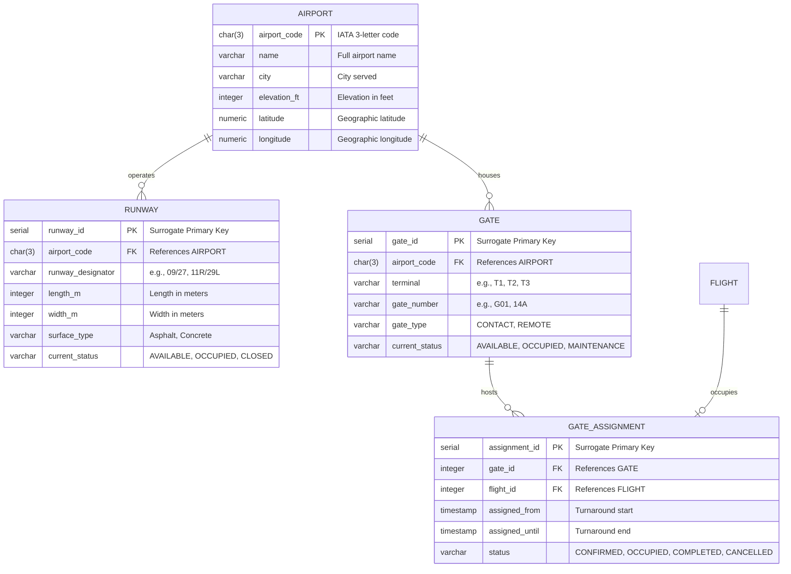

# SkyFlow: Member 1 Documentation
## Ground Infrastructure & Terminal Movement Module

---

### 1. Entity-Relationship (ER) Sub-Diagram
The following Mermaid diagram illustrates the entities, primary keys, and relationships owned and interacted with by Member 1:

---

### 2. Relational Schema Representation
Notation: Primary Keys are marked with `[PK]`, Foreign Keys are marked with `[FK]`.

* **`airport`** (
  `airport_code` [PK], 
  `name`, 
  `city`, 
  `elevation_ft`, 
  `latitude`, 
  `longitude`
)
* **`runway`** (
  `runway_id` [PK], 
  `airport_code` [FK ➔ `airport.airport_code`], 
  `runway_designator`, 
  `length_m`, 
  `width_m`, 
  `surface_type`, 
  `current_status`
)
  - *Candidate Key / Alternate Key:* `(airport_code, runway_designator)`
* **`gate`** (
  `gate_id` [PK], 
  `airport_code` [FK ➔ `airport.airport_code`], 
  `terminal`, 
  `gate_number`, 
  `gate_type`, 
  `current_status`
)
  - *Candidate Key / Alternate Key:* `(airport_code, terminal, gate_number)`
* **`gate_assignment`** (
  `assignment_id` [PK], 
  `gate_id` [FK ➔ `gate.gate_id`], 
  `flight_id` [FK ➔ `flight.flight_id`], 
  `assigned_from`, 
  `assigned_until`, 
  `status`
)
  - *Constraint:* `assigned_until > assigned_from`

---

### 3. Normalization Notes (1NF to 3NF)

#### A. First Normal Form (1NF)
* **Requirement:** Each column must contain atomic (indivisible) values, and each record must be unique.
* **Compliance:**
  - In `airport`, composite values like address are avoided; coordinates are broken into atomic `latitude` and `longitude`.
  - In `runway`, physical dimensions are stored separately as scalar integers (`length_m`, `width_m`) rather than combined strings like `"3800x45"`.
  - In `gate`, no repeating groups or comma-separated lists of flights exist. All time intervals and flights are decoupled into individual rows in `gate_assignment`.

#### B. Second Normal Form (2NF)
* **Requirement:** The table must be in 1NF and have **no partial functional dependencies** (every non-key attribute must depend on the whole primary key, not a proper subset of it).
* **Compliance:**
  - For `runway`, `gate`, and `gate_assignment`, surrogate primary keys (`SERIAL`: `runway_id`, `gate_id`, `assignment_id`) are single-attribute keys.
  - In relational theory, a partial dependency can only exist if the primary key is composite. Since our chosen PKs are single attributes, partial dependencies are mathematically impossible.
  - Even considering natural candidate keys such as `(airport_code, runway_designator)` for `runway`: attributes like `length_m` and `current_status` depend on the specific physical strip at that airport, not on `airport_code` alone.

#### C. Third Normal Form (3NF)
* **Requirement:** The table must be in 2NF and have **no transitive functional dependencies** ($X \rightarrow Y$ and $Y \rightarrow Z$, where $Y$ is not a superkey). Non-prime attributes must depend only on candidate keys.
* **Compliance:**
  - In `gate`, does `gate_type` determine `current_status`? No. Does `terminal` determine `current_status`? No. All non-key attributes (`terminal`, `gate_number`, `gate_type`, `current_status`) depend directly on `gate_id`.
  - In `gate_assignment`, we strictly store `gate_id` and `flight_id` along with assignment timestamps. We **do not** store flight arrival city, airline name, or aircraft model here. Doing so would create a transitive dependency (`assignment_id` $\rightarrow$ `flight_id` $\rightarrow$ `aircraft_model`). Those attributes remain strictly in Member 2's tables (`flight`, `aircraft`), preserving 3NF.

---

### 4. Overlap Prevention Rationale (Deliverable 3)
* **Problem:** Two flights cannot physically occupy the same gate at the same time.
* **Why not a simple UNIQUE constraint?** A standard `UNIQUE(gate_id, assigned_from)` only catches exact start-time matches. If Flight A is booked `10:00–11:00` and Flight B is requested `10:30–11:30`, a standard unique index fails to detect the conflict.
* **Trigger Solution:** A PostgreSQL `BEFORE INSERT OR UPDATE` trigger checks:
  $$\text{NEW.assigned\_from} < \text{assigned\_until} \quad \text{AND} \quad \text{NEW.assigned\_until} > \text{assigned\_from}$$
  If count $> 0$, it raises exception `'GATE_DOUBLE_BOOKED'`, cleanly rolling back the transaction. This complies with standard ANSI SQL principles taught in 3rd-semester CSE without requiring proprietary range-type extensions.
